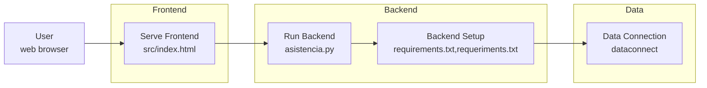

# Codebase Research Report

## Query
podrias se usa el proyecto?

## Answer
### System Diagram



### Summary
I'm still unable to find explicit usage instructions. Based on the directory structure, it appears to be a web application with Python backend components. Without more information, I can only provide a general overview of how such a project *might* be used.

```markdown
# CodeViz [Project Usage]

I was unable to find specific documentation or usage instructions for this project. However, based on the file structure, here's a general idea of how it might be used:

## Potential Usage

Since the project contains both JavaScript (`.js`) and Python (`.py`) files, it's likely a web application with a backend.

-   **Frontend:** The `src` directory contains HTML, CSS, and JavaScript files, suggesting a frontend interface.
    -   `src/index.html` (file:src/index.html) is likely the main entry point.
    -   `src/main/` (file:src/main/) contains various `.html` and `.js` files that might represent different pages or functionalities of the application (e.g., `asistencia_empleado.html` (file:src/main/asistencia_empleado.html), `empleados_form.html` (file:src/main/empleados_form.html), `gestionar-empleados.html` (file:src/main/gestionar-empleados.html)).
-   **Backend:** The `src/python` directory (file:src/python/) contains Python scripts, which likely handle backend logic.
    -   `asistencia.py` (file:src/python/asistencia.py) and `register.py` (file:src/python/register.py) might be related to the application's core functionality.
-   **Dataconnect:** The `dataconnect` directory (file:dataconnect/) suggests integration with a data source.

To use this project, you would likely need to:

1.  **Set up the backend:** Install the necessary Python dependencies (listed in `requirements.txt` (file:requirements.txt) or `requeriments.txt` (file:requeriments.txt)) and configure the data connection.
2.  **Run the backend:** Execute the main Python script (potentially `asistencia.py` (file:src/python/asistencia.py) or a similar entry point).
3.  **Serve the frontend:** Open `src/index.html` (file:src/index.html) in a web browser or use a web server to serve the frontend files.

**Note:** This is a general overview based on the file structure. Specific usage instructions would depend on the project's actual implementation and purpose.
```

## Walkthrough Steps

### 1. Project Overview
This project appears to be a web application built with both JavaScript and Python. The frontend, located in the `src` directory, likely provides the user interface. The backend, implemented in Python scripts within the `src/python` directory, handles the application's logic and data processing. The `dataconnect` directory suggests that the application interacts with a data source.

### 2. Backend Setup
To begin, set up the backend environment. This involves installing the necessary Python packages listed in `requirements.txt` or `requeriments.txt`. Then, configure the connection to the data source that the application uses. This step ensures that the backend has all the necessary dependencies and can communicate with the database.

### 3. Run the Backend
After setting up the environment, run the main Python script to start the backend server. This script, potentially `asistencia.py` or another similar entry point, will handle incoming requests and execute the application's core logic. Running the backend makes the application's functionalities accessible.

### 4. Serve the Frontend
To access the application's user interface, open `src/index.html` in a web browser. Alternatively, use a web server to serve the frontend files. This step makes the application accessible to users through their web browsers.

---
*Generated by [CodeViz.ai](https://codeviz.ai) on 6/14/2025, 12:53:28 AM*
